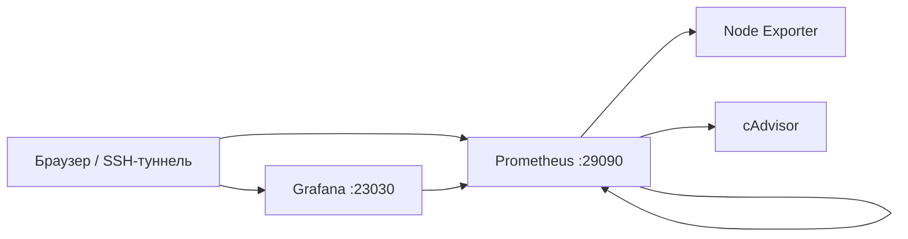

# Homelab — Linux, Docker Compose и мониторинг

Домашний сервер на Ubuntu Server для практики Linux и контейнеризации. Здесь находятся схема действующего homelab и отдельный воспроизводимый стенд мониторинга: Prometheus, Grafana, Node Exporter и cAdvisor.

Публичный Compose подготовлен на основе работающей конфигурации. Он использует отдельные тома и сеть, закреплённые образы и автоматически создаёт источник данных и дашборд Grafana. Это самостоятельный стенд, а не точная копия всех настроек домашнего сервера.

## Что можно запустить

| Компонент | Назначение |
| --- | --- |
| Prometheus | Сбор метрик каждые 15 секунд, хранение 15 дней |
| Node Exporter | CPU, память, файловая система и дисковый I/O Linux-хоста |
| cAdvisor | Метрики Docker-контейнеров |
| Grafana | Автоматически настроенный источник данных и дашборд Homelab Overview |



Дашборд содержит восемь панелей: доступность трёх целей, CPU, RAM, заполнение корневого раздела, CPU и память контейнеров, чтение и запись дисков. После старта скоростным метрикам нужны минимум два сбора, поэтому данные могут появиться через 30–60 секунд.

## Требования

Linux amd64, Docker Engine с обычным каталогом `/var/lib/docker`, Docker Compose v2+ и Python 3. Проверки не рассчитаны на rootless Docker. На Docker Desktop экспортеры не будут показывать метрики самого macOS/Windows-хоста; эта конфигурация предназначена для Linux-сервера.

Для четырёх сервисов заданы лимиты памяти суммарно около 1 GiB. Нужен запас RAM для ОС и остальных приложений.

## Запуск

```bash
git clone https://github.com/place3/homelab.git
cd homelab
python3 scripts/init_env.py
docker compose config --quiet
docker compose up -d
python3 scripts/verify_stack.py
```

`init_env.py` создаёт локальный `.env` со случайным паролем Grafana и правами 0600. Пароль не выводится в журнал; повторный запуск не перезаписывает файл. Вместо скрипта можно заполнить `.env` по `.env.example`; пустой пароль блокирует запуск Compose.

По умолчанию интерфейсы доступны только на localhost сервера:

- Grafana: `http://127.0.0.1:23030`, пользователь `admin`, пароль из `.env`.
- Prometheus: `http://127.0.0.1:29090`.

Эти порты выбраны отдельно от работающего homelab (3030/9090). При необходимости измените их в `.env` до старта. Имена контейнеров и томов формируются Compose, глобальных container_name нет.

Если сервер удалённый, на своём компьютере откройте SSH-туннель, заменив пользователя и адрес:

```bash
ssh -N -L 23030:127.0.0.1:23030 -L 29090:127.0.0.1:29090 user@server
```

После этого откройте указанные localhost-адреса в браузере компьютера. В Grafana выберите Dashboards → Homelab → Homelab Overview. Источник данных создаётся автоматически; пароль нужен только для входа в Grafana.

## Проверки и диагностика

```bash
docker compose ps

docker compose run --rm --no-deps --entrypoint /bin/promtool prometheus check config /etc/prometheus/prometheus.yml

python3 scripts/verify_stack.py --timeout 180
```

Проверка ожидает три цели в состоянии UP, доступную БД Grafana, рабочее соединение Grafana → Prometheus, загруженный дашборд и непустой результат PromQL каждой панели. Она не ограничивается наличием запущенных контейнеров.

[Как диагностировать проблемы](docs/monitoring.md) · [Что и где проверено](docs/verification.md)

GitHub Actions разворачивает отдельный стек на Ubuntu, проверяет Compose и конфигурацию Prometheus, затем выполняет те же HTTP/PromQL-проверки. Тестовый проект и его тома удаляются в конце job.

## Данные и остановка

```bash
docker compose down
```

Обычный `down` сохраняет именованные тома с метриками и состоянием Grafana. Параметр `--volumes` удаляет эти данные; CI использует его только для собственного временного проекта. Изменение пароля в `.env` после первого запуска не меняет пароль уже созданного пользователя в существующем томе Grafana.

## Связь с действующим homelab

На домашнем сервере также работают Nginx Proxy Manager, Pi-hole, Jellyfin, Navidrome и qBittorrent. Они отражают практику администрирования, но не включены в этот публичный Compose.

[Схема домашнего сервера и отличия публичного стенда](docs/homelab.md).

Образы закреплены по digest из работающего homelab: Prometheus 3.14.0, Grafana 13.2.2, Node Exporter 1.12.1 и cAdvisor 0.55.1. Проверена архитектура amd64; digest не обновляется автоматически.

Бэкапы, проверка восстановления, алерты и автоматическое развёртывание на домашний сервер пока не реализованы в этом репозитории. CI запускает только свой стенд и не имеет SSH-доступа к homelab.
