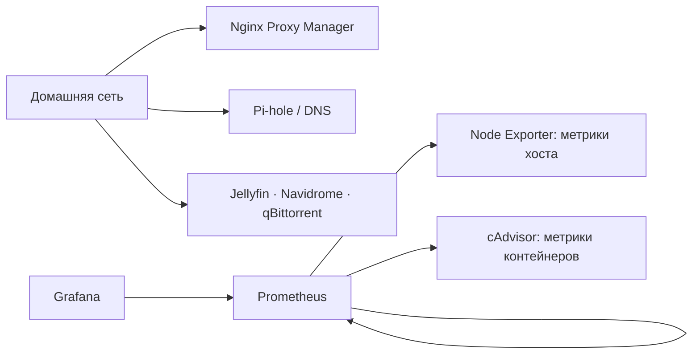

# Homelab — Ubuntu Server, Docker Compose и мониторинг

Документация моего домашнего сервера для практики Linux и контейнеризации. На одном Ubuntu Server работают четыре Compose-проекта: мониторинг, Nginx Proxy Manager, Pi-hole и медиасервисы.

## Архитектура

Схема показывает состав сервисов и сбор метрик. Маршруты reverse proxy к отдельным приложениям в ней не утверждаются: они пока не задокументированы.

## Сервисы

| Compose-проект | Состав | Назначение |
| --- | --- | --- |
| monitoring | Prometheus, Grafana, Node Exporter, cAdvisor | Сбор метрик хоста и контейнеров, визуализация |
| npm | Nginx Proxy Manager | Управление reverse proxy |
| pihole | Pi-hole | DNS в домашней сети |
| media | Jellyfin, Navidrome, qBittorrent | Медиасервисы |

## Проверка состояния

22 октября 2026 года проверено по SSH:

- Четыре Compose-проекта, 10 работающих контейнеров.
- Цели Prometheus `node_exporter`, `cadvisor` и `prometheus` имеют состояние `up`.
- Grafana отвечает на API health check; состояние базы — `ok`.
- `systemctl --failed` не показывает неисправных units.
- UFW активен; входящие соединения по умолчанию запрещены.

[Команды проверки и границы наблюдений](docs/verification.md).

## Что практикую

Запуск и наблюдение за сервисами через Docker Compose, диагностику состояния контейнеров, сбор метрик с Node Exporter и cAdvisor, работу с Prometheus и Grafana, администрирование Ubuntu Server по SSH.

## Текущее состояние репозитория

Здесь опубликована документация действующего стенда. Рабочие Compose-файлы и дашборды ещё не перенесены: сначала требуется отделить конфигурацию от секретов и локальных данных. Этот репозиторий пока не позволяет развернуть копию сервера одной командой.

Ближайшие улучшения: шаблоны конфигураций без секретов, фиксированные версии образов вместо `latest`, описание резервного копирования и проверка восстановления. Наличие контейнеров и метрик само по себе не подтверждает работоспособность бэкапов или алертов.
