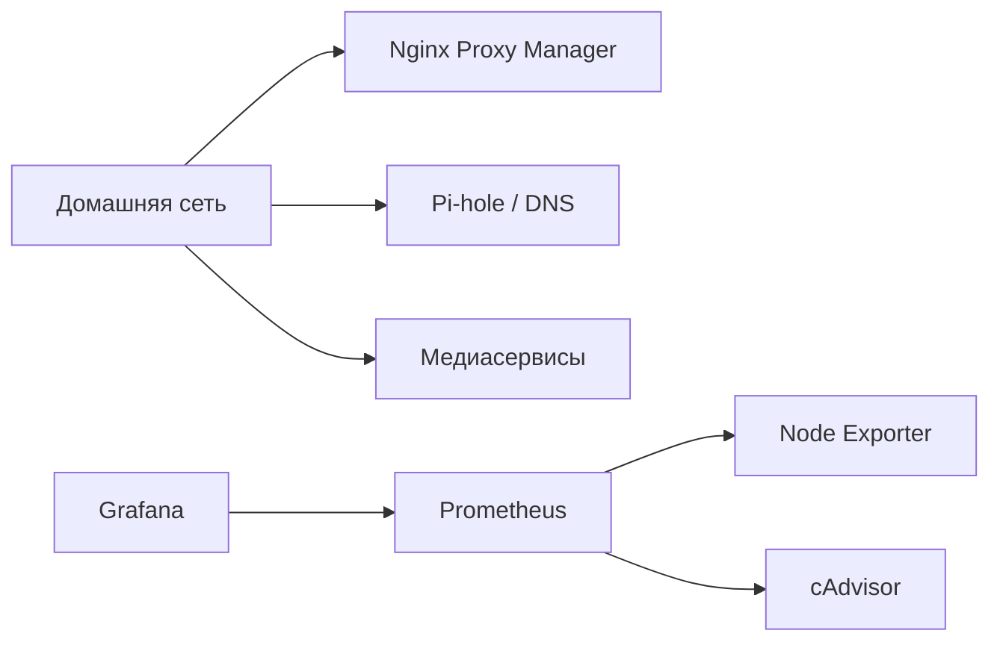

# Действующий домашний сервер

Ubuntu Server, один Linux-хост и четыре Compose-проекта:

| Проект | Состав |
| --- | --- |
| monitoring | Prometheus, Grafana, Node Exporter, cAdvisor |
| npm | Nginx Proxy Manager |
| pihole | Pi-hole |
| media | Jellyfin, Navidrome, qBittorrent |

Схема показывает состав сервисов. Конкретные маршруты Nginx Proxy Manager к
приложениям здесь не утверждаются: они отдельно не задокументированы.

## Откуда взялась публичная конфигурация

На работающем сервере проверены Compose и Prometheus. Сохранены те же роли четырёх
сервисов, scrape_interval 15s, три scrape job и retention 15d. Точные образы закреплены
по digest уже запущенных контейнеров. Версии Node Exporter и cAdvisor подтверждены
через build/version-метрики, Prometheus и Grafana — через API.

## Отличия публичного стенда

| Работающий homelab | Публичный Compose |
| --- | --- |
| Теги latest | Фиксированные digest |
| Локальные bind-каталоги с данными | Собственные именованные тома |
| Внешняя сеть homelab у части сервисов | Отдельная сеть проекта |
| Интерфейсы на 3030/9090, опубликованные на всех адресах | 23030/29090 только на localhost |
| Существующая учётная запись и дашборды Grafana | Новый случайный пароль и дашборд из Git |
| Развёртывание на домашнем сервере | Самостоятельный Compose-проект и интеграционная проверка в CI |

Дашборд Homelab Overview создан для публичного стенда; это не экспорт прежних
дашбордов пользователя. Восстановление данных Grafana и Prometheus, алерты и
автоматическое обновление образов не настроены в этой версии репозитория.

Экспортеры читают метрики хоста, поэтому им смонтированы Linux `/proc`, `/sys` и
rootfs. cAdvisor также читает информацию Docker через `/var/run` и `/var/lib/docker`.
Это конфигурация для доверенного сервера с Docker Engine; у обычного приложения
такие монтирования не нужны. Публичные сервисы не подключаются к другим сетям homelab.
